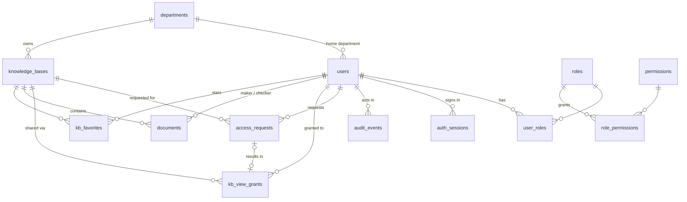
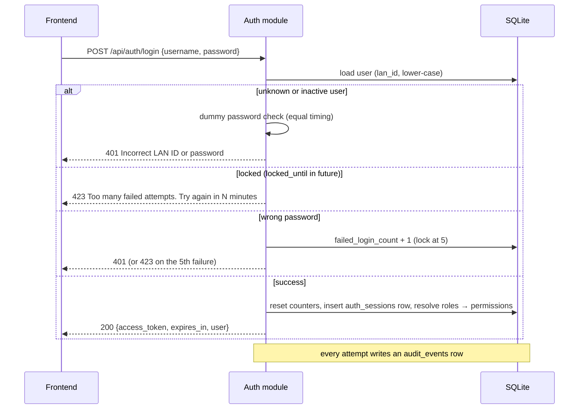

# Data Hub: Auth module and access control

This document is the technical reference for how Data Hub signs users in, what their access token contains, and how roles, departments and permissions decide what each user can do. It covers the SQLite schema behind it, the API, and the security controls.

- **Code:** `backend/app/` (entry point `main.py`)
- **Tests:** `backend/tests/`, 88 tests with one or more per requirement
- **Status:** demo. Accounts live in SQLite. Production would replace password checks with the bank's directory (see [Next steps](#next-steps)).

---

## 1. Requirements

| # | Requirement | Where it's enforced |
|---|---|---|
| R1 | User management is backed by SQLite. Sign-in checks LAN ID and password against it. | `services/auth.py` `authenticate` |
| R2 | The frontend gets a JWT from the auth module and sends it on every API call. The token carries **department, roles and permissions**. | `services/auth.py` (claims), `api/deps.py` |
| R3 | **System admin** creates knowledge bases and manages department admins. Not tied to a department. Can't upload, approve or view documents. | `core/permissions.py`, `services/authz.py` |
| R4 | **Department admin** maintains their department's knowledge bases and manages maker, checker and viewer access. Can't upload, approve or view documents. | same |
| R5 | Each user has exactly **one home department**. Each knowledge base belongs to **one department**. | `users.department_id`, `knowledge_bases.department_id` |
| R6 | **Maker** uploads, **checker** approves, both scoped to the department and covering all its knowledge bases. **One person can't be both.** | `MUTUALLY_EXCLUSIVE`, `services/roles.py` |
| R7 | Only a checker of the **same department as the maker** can approve a document. | `authz.can_review`, DB check `ck_documents_maker_checker` |
| R8 | By default users view only their own department's knowledge bases. **Viewers see approved documents only.** | `authz.kb_access`, `authz.visible_document_statuses` |
| R9 | View access to another department's knowledge base starts with the **user's request**, approved by that knowledge base's **department admin**. | `services/access_requests.py` |
| R10 | **Administration page** for system and department admins. System admins: all users, add users as **department admins** of any department, create departments, view roles and permissions. Department admins: their department's users only; add users to their own department as viewer, maker or checker. | `services/people.py`, `frontend/src/pages/AdminPage.tsx` |
| R11 | **Knowledge base detail page**: lists the files a user may see; makers upload files from an **Add ▾** menu. | `services/documents.py`, `frontend/src/pages/KnowledgeBaseDetailPage.tsx` |
| R12 | **Create knowledge base** (system admin): a pop-up to choose the department, enter a description, and choose a user from that department, by name and LAN ID, as department admin. | `services/knowledge_bases.create_kb`, `frontend/src/pages/CreateKnowledgeBaseForm.tsx` |

Security controls were added on top of these (section 7).

---

## 2. Roles and permissions

Roles are defined once in `backend/app/core/permissions.py` and synced into the `roles`, `permissions` and `role_permissions` tables **on every start-up**, so a new permission reaches existing databases without a reset. At sign-in, permissions are read from those tables, so the database is authoritative at runtime. Users signed in before a permission change get it at their next sign-in.

### Roles

| Role | Scope | Assigned by | Can hold with |
|---|---|---|---|
| `system_admin` | global, no department | seeded only (not assignable through the API) | nothing else |
| `department_admin` | home department | system admin | (not maker, not checker) |
| `maker` | home department | department admin of that department | (not checker, not department admin) |
| `checker` | home department | department admin of that department | (not maker, not department admin) |
| `viewer` | home department | **implicit**: every department member who isn't a department admin | maker or checker |

### Permission matrix

| Permission | system_admin | department_admin | maker | checker | viewer |
|---|:-:|:-:|:-:|:-:|:-:|
| `workflows:view` | ✔ | | | | |
| `kb:create` | ✔ | | | | |
| `kb:update` | ✔ (any) | ✔ (own dept) | | | |
| `kb:view` | | | | | ✔ |
| `users:view` | ✔ (all) | ✔ (own dept) | | | |
| `users:create` | ✔ (department admins, any dept) | ✔ (viewer/maker/checker, own dept) | | | |
| `departments:manage` | ✔ | | | | |
| `roles:view` | ✔ | | | | |
| `department_admins:manage` | ✔ | | | | |
| `department_roles:manage` (maker, checker) | | ✔ (own dept) | | | |
| `access_requests:decide` | | ✔ (own dept's KBs) | | | |
| `access_requests:create` | | | | | ✔ |
| `documents:view` (approved) | | | | | ✔ |
| `documents:view_unapproved` | | | ✔ (own dept) | ✔ (own dept) | |
| `documents:upload` | | | ✔ (own dept) | | |
| `documents:approve` | | | | ✔ (own dept, maker's dept) | |

A permission says what *kind* of action a user may take. The scope in brackets ("own dept", "maker's dept", a view grant) is checked by the policy functions in `services/authz.py`. Makers and checkers also hold `viewer`, so their effective permissions are the union of both.

### Who sees a knowledge base, and how

`authz.kb_access()` returns one of these:

| Value | Meaning | Who |
|---|---|---|
| `admin` | can manage it, can't see its documents | system admin (every KB); department admin (own department's KBs) |
| `department` | member of the owning department | any viewer, maker or checker in that department |
| `granted` | view-only access via an approved request | members of other departments |
| *none* | invisible; the API answers **404**, not 403, so it doesn't reveal that it exists | everyone else |

### Which documents a user sees

| Who | Statuses visible |
|---|---|
| Viewer of own department, or with granted access | `approved` |
| Maker or checker of the knowledge base's department | `approved`, `pending_approval`, `rejected` |
| System admin, department admin | none (**403**: admins manage knowledge bases and people only) |

---

## 3. Access token

`POST /api/auth/login` returns an HS256-signed JWT that is valid for 60 minutes (configurable). Example for a checker:

```json
{
  "sub": "risk.checker",
  "uid": 5,
  "jti": "1264c2b2-c6f7-4883-be54-e644f9bc8915",
  "name": "Risk Checker",
  "dept": { "id": 1, "code": "RISK", "name": "Risk Management" },
  "roles": ["checker", "viewer"],
  "perms": ["access_requests:create", "documents:approve", "documents:view",
            "documents:view_unapproved", "kb:view"],
  "iss": "data-hub",
  "aud": "data-hub-api",
  "iat": 1794138511,
  "exp": 1794142111
}
```

| Claim | Meaning |
|---|---|
| `sub` | LAN ID (lower-case) |
| `uid` | user id |
| `jti` | session id: a row in `auth_sessions` |
| `dept` | home department; `null` for system admins |
| `roles` | effective roles, including the implicit `viewer` |
| `perms` | permissions granted by those roles |
| `iss`, `aud`, `iat`, `exp` | verified on every request |

### How a request is authorised

Every protected endpoint depends on `api/deps.current_principal`, which:

1. verifies the signature, `exp`, `iss`, `aud` and required claims;
2. loads the `auth_sessions` row for `jti` and rejects it if the row is missing, revoked or expired, which is what makes **sign-out immediate**;
3. loads the user and rejects inactive users;
4. builds a `Principal` (LAN ID, department, roles, permissions) **from the token's claims**;
5. hands it to the service layer, which applies the scope rules in `services/authz.py`.

### Keeping claims fresh

Roles are copied into the token at sign-in. When someone's roles change (`PUT` or `DELETE /api/users/{lan_id}/roles/{role}`), **all their sessions are revoked**. Their next request returns 401, and signing in again issues a token with the new roles. View grants are deliberately **not** in the token: they're checked against `kb_view_grants` on each request, so an approval takes effect immediately and the token stays small.

---

## 4. Database

SQLite file: `backend/data/datahub.db`. It's created and seeded with demo data on first start-up, and ignored by git. Foreign keys are switched on for every connection (`PRAGMA foreign_keys=ON`). All timestamps are stored in UTC.



### Tables

**`departments`**: `id`, `code` (unique, e.g. `RISK`), `name`, `created_at`.

**`users`**

| Column | Notes |
|---|---|
| `lan_id` | unique, stored lower-case; sign-in is case-insensitive |
| `display_name`, `title`, `email` | `email` unique |
| `password_hash` | `pbkdf2_sha256$<iterations>$<salt>$<hex>` |
| `department_id` | home department; **NULL only for system admins** |
| `is_active` | inactive users can't sign in, and their tokens stop working |
| `failed_login_count`, `locked_until` | lockout state (section 7) |
| `last_login_at`, `created_at`, `updated_at` | |

**`roles`** (`code`, `name`, `description`, `scope` global/department, `assignable`), **`permissions`** (`code`, `description`) and **`role_permissions`** (role ↔ permission) are seeded from `core/permissions.py`.

**`user_roles`**: `user_id`, `role_id` (composite PK), `assigned_by_id`, `assigned_at`. Department-scoped roles apply to the user's home department. The implicit `viewer` role is **not** stored.

**`auth_sessions`**: one row per issued token. `id` = JWT `jti`, `user_id`, `issued_at`, `expires_at`, `revoked_at`, `revoked_reason` (`logout` or `roles_changed`), `ip_address`, `user_agent`.

**`audit_events`**: `occurred_at`, `actor_id`, `actor_lan_id` (kept even for unknown LAN IDs), `action`, `outcome` (success/failure), `target_type`, `target_id`, `detail` (JSON), `ip_address`. Actions:

| Action | When |
|---|---|
| `auth.login`, `auth.lockout`, `auth.logout` | sign-in attempts and sessions |
| `user.create`, `department.create` | people and organisation |
| `role.assign`, `role.revoke` | role changes |
| `kb.create`, `kb.update` | knowledge base changes |
| `access.request`, `access.approve`, `access.reject`, `access.revoke` | cross-department access |
| `document.upload`, `document.download`, `document.approve`, `document.reject` | maker-checker |

**`knowledge_bases`**: `id` (URL slug), `name`, `description`, `department_id` (owner, required), `admin_id` (the department admin named at creation), `created_by_id`, `created_at`, `updated_at`.

**`access_requests`**: `kb_id`, `requester_id`, `reason`, `status` (`pending` / `approved` / `rejected`), `decided_by_id`, `decided_at`, `decision_note`, `created_at`. A **partial unique index** allows at most one *pending* request per user per knowledge base.

**`kb_view_grants`**: `kb_id`, `user_id` (composite PK), `request_id`, `granted_by_id`, `granted_at`. Deleting the row revokes access.

**`documents`**: `kb_id`, `title`, `filename`, `content_type`, `size_bytes`, `storage_path`, `status` (`pending_approval` / `approved` / `rejected`), `maker_id`, `checker_id`, `submitted_at`, `decided_at`, `rejection_reason`. A database CHECK constraint (`checker_id <> maker_id`) makes self-approval impossible even if the service layer had a bug. Files live on local disk under `backend/data/uploads/<kb_id>/<document_id>-<filename>` (`services/storage.py`); `storage_path` is relative to that folder.

**`kb_favorites`**: `user_id`, `kb_id`: per-user stars.

### Schema changes

There are no Alembic migrations yet. On start-up, `init_db` creates missing tables and **adds missing nullable columns** to existing tables, so additive changes (like the document file columns) reach existing databases without a reset. Anything else (renames, new required columns) needs a reset or a real migration.

### Rules not expressible in SQLite

These span rows, so they're enforced in the service layer and covered by tests:

- mutually exclusive roles (`services/roles.py`);
- department-scoped roles need a home department;
- system admins hold no other role.

---

## 5. Flows

### Sign-in



### Maker-checker

Approval is run by the **workflow module**. See [approval-workflow.md](approval-workflow.md) for its design, tables, API and the SpiffWorkflow plan. The rules below are enforced by its document handler.

1. A **maker** uploads files: `POST /api/knowledge-bases/{kb}/documents` (multipart). Each file becomes a document in `pending_approval`.
   - **Allowed types:** `.pdf .docx .doc .xlsx .xls .pptx .csv .txt .md`.
   - **Size:** up to 25 MB each, and empty files are refused.
   - **All or nothing:** if any file in a batch is refused, nothing from that batch is stored.
   - **File names:** directory parts are stripped from uploaded names, so a file can't be written outside its folder.
2. A **checker** from the same department as the knowledge base *and* the maker either:
   - **approves**: `POST /api/documents/{id}/approve`, which makes it `approved`; or
   - **rejects**: `POST /api/documents/{id}/reject` with a reason, which makes it `rejected`.
3. Viewers see the document only once it's `approved`.

### Cross-department view access

1. A user from another department finds the knowledge base in `GET /api/knowledge-bases/directory`, which lists names and departments only, never documents.
2. They request access: `POST /api/knowledge-bases/{kb}/access-requests {reason}`.
3. The knowledge base's department admin sees the request in `GET /api/access-requests?status=pending`.
4. The department admin decides: `POST /api/access-requests/{id}/approve`, which creates a `kb_view_grants` row, or `/reject`.
5. The user now sees the knowledge base with `access: "granted"`, and its approved documents only.
6. The department admin can later revoke access: `DELETE /api/knowledge-bases/{kb}/viewers/{lan_id}`.

---

## 6. Administration page

Shown in the sidebar (gear icon, above the account row) to system admins and department admins only.

| Tab | System admin | Department admin |
|---|---|---|
| **Users** | Everyone, all departments. **Add user** picks any department; the new user is always a **department admin**. | Own department only. **Add user** adds to own department as **viewer** (default), **maker** or **checker**. |
| **Departments** | List with members, knowledge bases and admins. **Add department** (code + name). | not shown |
| **Roles** | Read-only: each role's scope, description and permissions. | not shown |
| **Permissions** | Read-only: each permission and the roles that grant it. | not shown |

The admin sets an initial password (at least 8 characters) for each new user and shares it securely. With directory sign-in, accounts would be provisioned from Active Directory instead.

Field rules: LAN ID is 2–64 characters (letters, numbers, `.`, `-`, `_`) and stored lower-case; LAN ID and email must be unique; department code is 2–16 characters (letters, numbers, `_`), stored upper-case and unique, and department names must be unique.

### Creating a knowledge base

The system admin's **Create knowledge base** button opens a pop-up:

| Field | Notes |
|---|---|
| **Name** | required |
| **Department** | chosen from the department list |
| **Description** | optional |
| **Department admin** | users of the chosen department, shown as name and LAN ID, in three groups: **Department admins** (preselected if there's exactly one); **Will be made department admin** (viewers, with a warning when one is chosen); and **Can't be admin** (makers and checkers, disabled, because the roles are mutually exclusive). |

The admin is recorded on the knowledge base and shown on its page. Promoting a viewer and creating the knowledge base happen in one transaction: if the promotion is refused, nothing is created. The promoted user is signed out so their next token carries the new role.

Naming an admin doesn't change access: any department admin of that department can still maintain the knowledge base. Whether only the named admin should is one of the parked access questions.

## 7. Knowledge base detail page

Clicking a knowledge base name opens `#kb/<id>`. The page uses the browser's history, so Back and Forward work and the address can be bookmarked. It shows:

- **‹ All knowledge bases**, then the name with a favourite star, the description, the owning department and when it was last updated.
- **Search by name**, plus a **status filter** (All / Approved / Pending approval / Rejected) for makers and checkers.
- **Add ▾ → Upload files**, for makers only. You can choose several files at once, and they're uploaded together.
- A table of **Name** (click to download), **Status**, **Added on**, **Added by** and **Actions** (⋮). Actions offers Download to everyone, and **Approve** or **Reject…** to checkers on pending documents. Rejecting asks for a reason, which then shows when you hover over the Rejected badge.

The page has two tabs, modelled on Quick's knowledge base page:

| Tab | Shows |
|---|---|
| **Documents (n)** | The file list above. |
| **Activity** | A timeline, newest first. **Uploaded** rows say who uploaded the file and when; while it's still waiting they're marked **Pending approval**. **Approved** and **Rejected** rows say which checker decided and when, with the reason for rejections. A summary counts files pending approval, and a filter shows uploads, approvals or rejections only. It refreshes after uploads and decisions. Viewers see activity for approved files only. Admins don't get the tabs. |

The page asks the server what the user may do (`capabilities`) instead of working it out from roles, so the server stays the single source of truth.

| User | Sees | Can |
|---|---|---|
| Maker | all statuses | upload, download |
| Checker | all statuses | download, approve, reject |
| Viewer (own department or granted) | approved only | download |
| Department admin, system admin | the knowledge base, but no documents | — |

## 8. API reference

All endpoints are under `/api`. Interactive docs: http://localhost:8000/docs. Errors return `{"detail": "<message>"}`.

| Method | Path | Who | Purpose |
|---|---|---|---|
| POST | `/auth/login` | anyone | Sign in; returns the token and user (department, roles, permissions) |
| POST | `/auth/logout` | signed in | End this session (204) |
| GET | `/auth/me` | signed in | Current user |
| GET | `/departments` | system admin (all), department admin (own) | Departments with member and KB counts, and admins |
| POST | `/departments` | system admin | Create a department `{code, name}` |
| GET | `/users?department=CODE` | system admin (all), department admin (own) | Users and assigned roles |
| POST | `/users` | system admin → department admin in any department; department admin → viewer/maker/checker in own department | Add a user with an initial password |
| GET | `/roles` · `/permissions` | system admin | Roles with their permissions; permissions with the roles that grant them |
| PUT / DELETE | `/users/{lan_id}/roles/{role}` | system admin → `department_admin`; department admin → `maker`, `checker` | Assign or remove a role; ends the user's sessions |
| GET | `/knowledge-bases` | signed in | KBs you can see, with `access` and `favorite` |
| GET | `/knowledge-bases/directory` | signed in | All KBs (no documents), with your access and any pending request |
| POST | `/knowledge-bases` | system admin | Create a KB: `{name, description, department_code, admin_lan_id}`. The admin must be in that department. A viewer is made department admin in the same transaction; makers and checkers are refused (409). |
| PATCH | `/knowledge-bases/{kb}` | system admin, or that department's admin | Edit name or description |
| PUT / DELETE | `/knowledge-bases/{kb}/favorite` | anyone who can see it | Star or unstar |
| GET | `/knowledge-bases/{kb}/viewers` | that department's admin | Users from other departments with access |
| DELETE | `/knowledge-bases/{kb}/viewers/{lan_id}` | that department's admin | Revoke granted access |
| POST | `/knowledge-bases/{kb}/access-requests` | members of *other* departments (not admins) | Request view access |
| GET | `/access-requests?status=` | signed in | Your requests; department admins also see requests for their KBs |
| POST | `/access-requests/{id}/approve` · `/reject` | the KB's department admin | Decide a request |
| GET | `/knowledge-bases/{kb}` | anyone who can see it | One KB plus your `capabilities` (`view_documents`, `view_unapproved`, `upload`, `review`, `edit`) |
| GET | `/knowledge-bases/{kb}/documents` | viewers, makers, checkers (not admins) | Documents you may see |
| GET | `/knowledge-bases/{kb}/activity` | viewers, makers, checkers (not admins) | Uploads and approve/reject decisions for the documents you may see, newest first; built from the workflow history |
| POST | `/knowledge-bases/{kb}/documents` | makers of the KB's department | Upload one or more files (multipart field `files`); each becomes `pending_approval` |
| GET | `/documents/{id}/download` | anyone who may see that document | The file; viewers can download approved documents only |
| POST | `/documents/{id}/approve` · `/reject` | checkers of the maker's department | Decide a document; reject needs a reason (completes its workflow task) |
| GET / POST | `/workflow/...` | see [approval-workflow.md](approval-workflow.md#5-api) | Inbox, task completion, history, definitions |

Status codes: **401** not signed in or session ended · **403** signed in but not allowed · **404** not found *or* not visible to you · **409** conflicts with current state (duplicate request, exclusive roles, already decided) · **422** invalid input · **423** account locked.

---

## 9. Security controls

| Control | Detail |
|---|---|
| Password hashing | PBKDF2-HMAC-SHA256, 600,000 iterations (OWASP 2023), 16-byte random salt per user; constant-time comparison |
| No LAN ID enumeration | Unknown and inactive users get the same 401 message, and the server runs a dummy hash so response time matches a real check. Tested. |
| Account lockout | 5 consecutive failures lock the account for 15 minutes (both configurable). A correct password is refused while locked. Success resets the counter. |
| Server-side sign-out | `POST /auth/logout` revokes the session row; the token fails immediately. |
| Stale-role protection | Role changes revoke the user's sessions. |
| Token verification | Signature, expiry, issuer, audience and required claims are checked on every request. Tampered tokens are rejected (tested). |
| Signing key | The app refuses to start with the development key when `DATAHUB_ENVIRONMENT=production`, and logs a warning in development. |
| Least privilege by default | Hidden KBs return 404. Admin roles can't see documents. Self-approval is blocked in code and by a DB constraint. |
| Audit trail | Every sign-in attempt, role change, access decision and document decision is recorded in `audit_events`, in the same transaction as the change. |

**Known trade-off:** the 423 "locked" message tells an attacker the LAN ID exists, but only after 5 wrong attempts against it. That's normal for internal banking apps and gives real users a clear message. Change `AccountLocked` to `Unauthenticated` in `services/auth.py` if policy prefers a uniform 401.

---

## 10. Configuration

All settings use the `DATAHUB_` prefix and can live in `backend/.env` (see `backend/.env.example`).

| Variable | Default | Notes |
|---|---|---|
| `DATAHUB_ENVIRONMENT` | `development` | `production` enforces a real signing key |
| `DATAHUB_DATABASE_URL` | `sqlite:///backend/data/datahub.db` | any SQLAlchemy URL |
| `DATAHUB_SEED_DEMO_DATA` | `true` | seeds only if the database is empty |
| `DATAHUB_JWT_SECRET` | dev value | **required** in production: at least 32 random characters |
| `DATAHUB_ACCESS_TOKEN_MINUTES` | `60` | |
| `DATAHUB_PASSWORD_HASH_ITERATIONS` | `600000` | tests use 1000 |
| `DATAHUB_MAX_FAILED_LOGINS` | `5` | |
| `DATAHUB_LOCKOUT_MINUTES` | `15` | |
| `DATAHUB_UPLOAD_DIR` | `backend/data/uploads` | where uploaded files are stored |
| `DATAHUB_MAX_UPLOAD_MB` | `25` | per file |

Reset the demo database: `cd backend && .venv/bin/python -m app.db.reset`.

---

## 11. Demo accounts

| LAN ID | Password | Department | Roles | Demonstrates |
|---|---|---|---|---|
| `admin` | `admin123` | — | system admin | create KBs, manage department admins |
| `analyst` | `datahub123` | Risk | viewer | own KB + **granted** HR Policies; pending request for AML & Compliance |
| `risk.admin` | `demo123` | Risk | department admin | manage Risk makers and checkers; decide requests for Credit Risk |
| `risk.maker` | `demo123` | Risk | maker | submit documents to Credit Risk |
| `risk.checker` | `demo123` | Risk | checker | approve or reject Risk documents |
| `hr.admin` · `hr.maker` · `hr.checker` | `demo123` | HR | admin · maker · checker | the same set for HR Policies |
| `comp.admin` | `demo123` | Compliance | department admin | has the analyst's pending request to decide |
| `comp.officer` | `demo123` | Compliance | viewer | no grants: sees only AML & Compliance |
| `data.admin` | `demo123` | Data Office | department admin | |

Seeded documents (small PDFs you can download) in Credit Risk: one approved, one pending, one rejected. In HR Policies: one approved, one pending.

---

## 12. Code map

```
backend/app/
├── core/
│   ├── config.py         settings (DATAHUB_*), production key check
│   ├── permissions.py    roles, permissions, exclusivity rules: the single source of truth
│   └── security.py       PBKDF2 hashing, dummy hash, JWT encode/decode
├── db/
│   ├── models.py         SQLAlchemy tables (section 4)
│   ├── session.py        engine, per-request session, init_db / reset_database
│   ├── seed.py           demo data
│   └── reset.py          `python -m app.db.reset`
├── services/             business rules, no HTTP
│   ├── auth.py           sign-in, lockout, sessions, token claims → Principal
│   ├── authz.py          policy: KB visibility, document visibility, who may approve/assign
│   ├── roles.py          assign/revoke with exclusivity rules
│   ├── people.py         add users and departments
│   ├── knowledge_bases.py, access_requests.py, documents.py
│   ├── document_approval.py  documents as a workflow subject (rules + outcome → status)
│   ├── storage.py        local-disk file storage (safe names, path checks)
│   ├── audit.py          audit_events writer
│   └── errors.py         DomainError → HTTP status (mapped in main.py)
├── workflow/             approval workflow module (see approval-workflow.md)
├── api/                  thin FastAPI routers
│   ├── deps.py           current_principal (token + session check), require(perm)
│   └── auth.py, people.py, knowledge_bases.py, access_requests.py, documents.py
└── schemas/              Pydantic request/response models
```

---

## Next steps

1. **Directory sign-in.** Replace the password check in `services/auth.authenticate` with an LDAP bind against Active Directory (or OIDC/SAML SSO). Keep `users` as the local profile and role store, mapping AD attributes to `department_id` on each sign-in. Everything after the password check stays the same.
2. **Migrations.** Move from `create_all` to Alembic before any schema change touches real data.
3. **Token storage in the browser.** The frontend keeps the token in `sessionStorage`. For production, prefer an HttpOnly, Secure, SameSite cookie so scripts can't read it.
4. **Object storage.** Files are on local disk. Before production, move `services/storage.py` to an object store (e.g. S3) and add virus scanning on upload.
5. **More screens in the UI.** The Administration page covers users and departments. The APIs for changing a user's role, access requests and the maker-checker queue exist; the frontend doesn't use them yet.
6. **Per-IP rate limiting** at the gateway, to complement per-account lockout.
